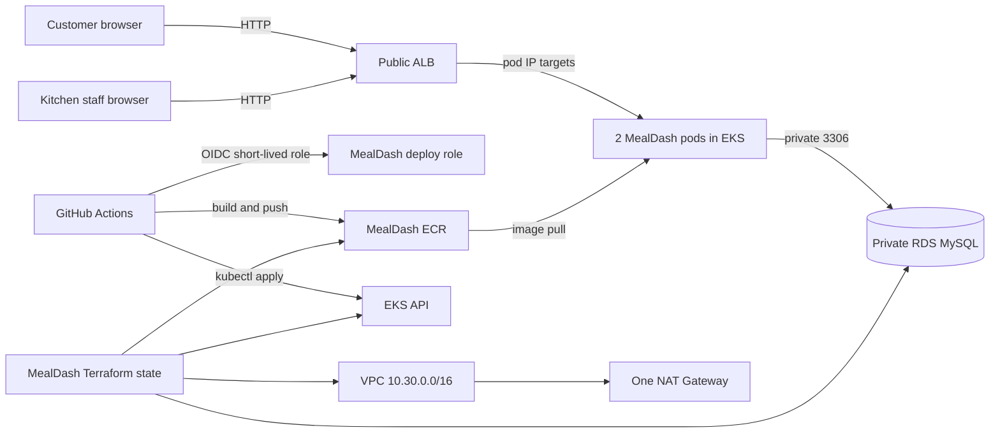

# MealDash architecture

## Traffic and data

The AWS Load Balancer Controller watches the `mealdash` Ingress and creates a public Application Load Balancer in the MealDash public subnets. It forwards requests to pod IP targets on the EKS nodes. Customer ordering, order tracking, and kitchen staff screens share the app; staff updates are protected by a password and Flask session. RDS is private and accepts MySQL traffic only from the MealDash EKS node security group.

The application persists restaurants, menu items, orders, and order line items in MySQL. New kitchens and menu entries are seeded idempotently at application startup. Each order has a random tracking code and a status state machine. Checkout is simulated; the application does not integrate with or charge a payment provider.

## AWS foundation

Terraform creates a VPC using `10.30.0.0/16`, two public and two private subnets across two AZs, one NAT Gateway, an EKS cluster named `mealdash`, a small managed node group, a private single-AZ MySQL database, an encrypted immutable ECR repository, CloudWatch EKS control-plane logs, and a GitHub Actions role/access entry. This is isolated from Project 2's `10.20.0.0/16`, `eventpass` EKS cluster, ECR repository, RDS identifier, IAM deploy role, and Kubernetes namespace.

The AWS GitHub OIDC provider is a single account-level integration for `token.actions.githubusercontent.com`. MealDash reads that existing provider and owns a separate role whose trust condition names only the MealDash repository and its `classroom` GitHub environment. Project 2 must not delete the provider while MealDash depends on it. For independent teardown, move the provider to a shared IAM bootstrap state and reference it from each capstone's separate Terraform state.

## CI/CD

The pull request build-check builds the Docker image without AWS permissions. Main branch pushes and manual workflow dispatch can then obtain short-lived AWS credentials through OIDC, authenticate to ECR, push an immutable run-specific tag, update kubeconfig, apply public DB connection settings as a ConfigMap, and update the application with Kustomize. The Action role has ECR push permissions, EKS cluster describe permission, and namespaced Kubernetes deploy permissions. It cannot read runtime Kubernetes Secrets.

The instructor bootstrap script reads the RDS managed password from Secrets Manager locally and creates Kubernetes Secrets for the DB password, staff password, and Flask signing key. They never go into GitHub variables or the image. The AWS Load Balancer Controller has a separate cluster-specific IRSA role and IAM policy.

## Classroom limitations

The ALB uses HTTP, public EKS API access is not source-CIDR restricted, MySQL is single-AZ without retained backups, and the node group begins at one small instance. These settings keep the demonstration straightforward and lower its footprint. They are not a production availability or security baseline.
